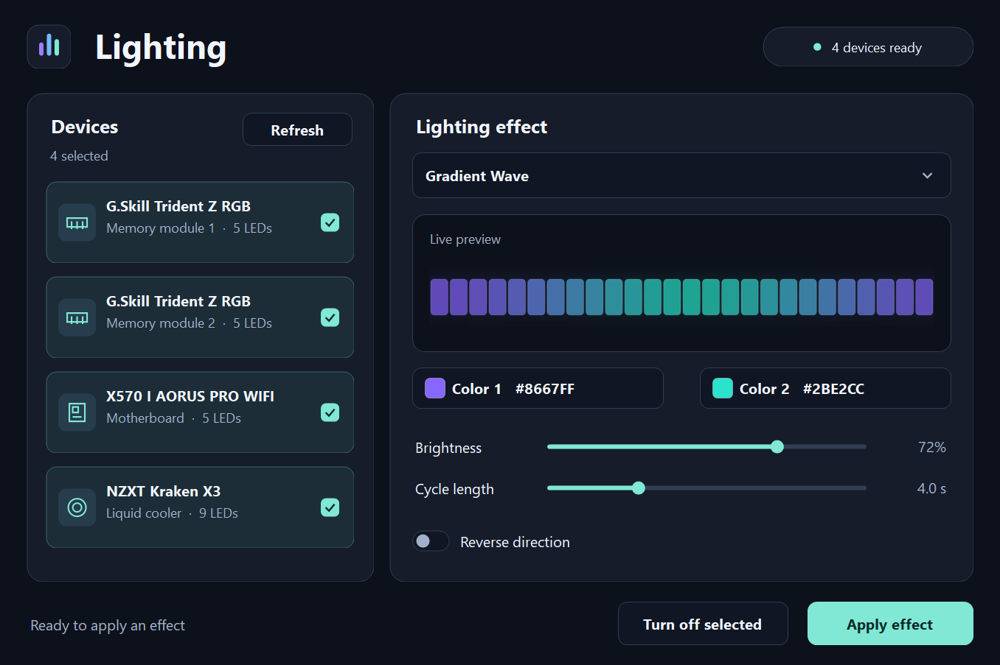

# RGB Panel Direct

A small Windows utility for controlling the RGB lighting on a Gigabyte X570 I AORUS PRO WIFI build. It drives the supported USB and SMBus lighting controllers from a single executable. OpenRGB does not have to be installed or running.



## Download

Get `RGB-Panel-Direct.exe` from [Releases](https://github.com/petrochen/rgb-panel-direct/releases). Run it on Windows 10 or 11 x64 and approve the Windows administrator prompt. The G.Skill memory modules require the [PawnIO driver](https://pawnio.eu/).

Select one or more devices, pick an effect, and click **Apply effect**. Devices can run different effects at the same time. The preview updates while you adjust the colors, brightness, cycle length, or direction. Keep the panel open while an animation is running.

## Supported hardware

| Device | Lighting |
| --- | --- |
| G.Skill Trident Z RGB DDR4 | Two five-LED modules with ENE `DIMM_LED-0103` controllers on the target AMD SMBus |
| NZXT Kraken X3 | Eight-LED ring and logo |
| Gigabyte X570 I AORUS PRO WIFI | Five RGB Fusion 2 USB lighting channels |

Effects include Solid Color, Gradient, Color Fade, Breathing, Gradient Wave, Rainbow Wave, Spectrum Cycle, and Comet. A separate button turns off the selected devices.

The interface was checked at 100% and 150% display scaling. Direct animation frames were sent successfully to the Kraken and AORUS controllers. The direct RAM write and readback still needs an elevated hardware test.

## Build from source

From a PowerShell prompt on Windows x64, run:

```powershell
.\DirectBuild.ps1
```

The build uses the Windows .NET Framework C# compiler and embeds the signed `SmbusPIIX4.bin` module. The output is `RGB Panel Direct.exe`.

## License

The application is available under [GPL-2.0-or-later](LICENSE). [Third-party notices](DirectNotices.txt) identify the upstream projects.
